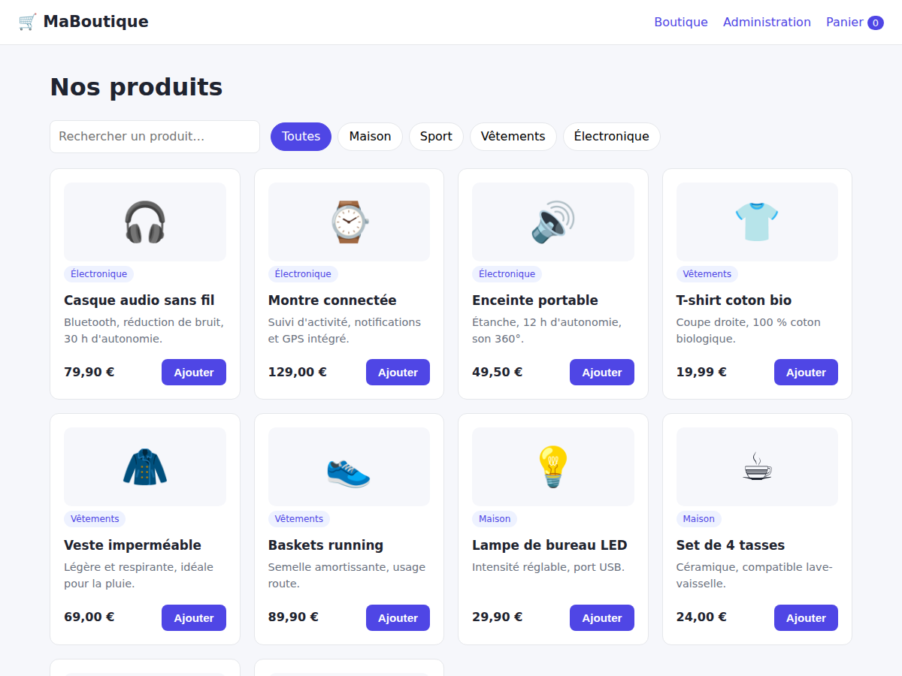
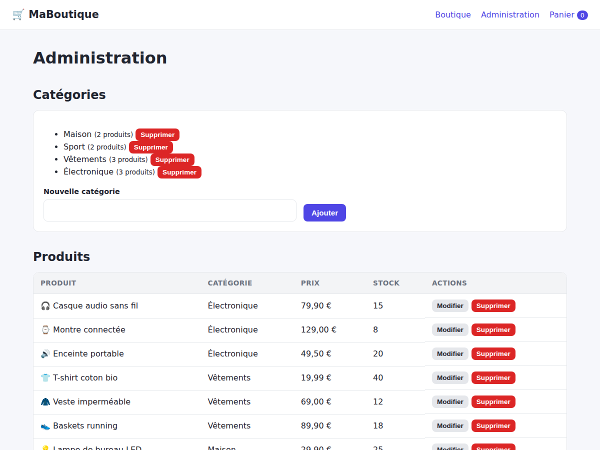

# Site e-commerce (Flask + SQLite)

Boutique en ligne complète : catalogue de produits par catégories, panier, validation de
commande et espace d'administration. Front en HTML / CSS / JavaScript, back en Python (Flask)
avec une base de données SQLite.



## Fonctionnalités

- **Catalogue** : liste des produits, filtre par catégorie, recherche par mot-clé, gestion des ruptures de stock
- **Panier** : ajout, modification des quantités, suppression, total (conservé dans le navigateur)
- **Commande** : validation côté serveur (stock, prix recalculés depuis la base, transaction atomique)
- **Administration** (`/admin.html`) : ajout, modification et suppression des produits et des catégories, liste des commandes
- **Design responsive** : adapté aux ordinateurs, tablettes et smartphones



## Technologies

- Front : HTML5, CSS3 (Grid / Flexbox), JavaScript (fetch API, localStorage)
- Back : Python, Flask (API REST JSON)
- Base de données : SQLite

## Base de données

```
categories (id, name)
products   (id, name, description, price, stock, emoji, category_id → categories)
orders     (id, customer_name, email, total, created_at)
order_items(id, order_id → orders, product_id → products, product_name, unit_price, quantity)
```

Le nom et le prix du produit sont copiés dans `order_items` au moment de la commande :
l'historique reste exact même si le produit est modifié ou supprimé.

## API

| Méthode | Route | Description |
|---|---|---|
| GET | `/api/products?category=&q=` | Liste / filtre / recherche |
| POST, PUT, DELETE | `/api/products[/id]` | Gestion des produits |
| GET, POST, DELETE | `/api/categories[/id]` | Gestion des catégories |
| POST | `/api/orders` | Valide une commande |
| GET | `/api/orders` | Liste des commandes |

## Installation

```bash
pip install -r requirements.txt
python app.py
```

Ouvrir ensuite http://127.0.0.1:5000. La base `shop.db` est créée automatiquement au
premier lancement avec des produits d'exemple.

## Structure

```
├── app.py            # API Flask
├── schema.sql        # création des tables
├── seed.sql          # données d'exemple
├── requirements.txt
└── static/
    ├── index.html    # catalogue
    ├── cart.html     # panier et commande
    ├── admin.html    # administration
    ├── css/style.css
    └── js/           # common.js, shop.js, cart.js, admin.js
```

## Pistes d'amélioration

- Authentification pour protéger la page d'administration
- Comptes clients et historique de commandes
- Paiement en ligne (Stripe) et envoi d'e-mails de confirmation
- Images de produits et pagination
